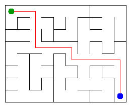

# Assignment 3. Maze Escape

- Student ID: 250780
- Name: Muratkhanov Bauyrzhan
- Group: SE-2519
- Maze size (rows x columns): 8 x 10

I generated my input files with `java tools/MakeVariant.java 250780 data`.
My maze has 80 cells, 142 inner walls and 109 one-way slides.

## Program output

I obtained these 13 lines with `java -cp out Main`:

    Broken: 79
    Kept: 63
    Last broken wall: 90
    MST cost: 24566
    Heaviest broken wall: 969
    Path length: 16
    DFS visited: 42
    Dead ends: 27
    Zones: 10
    Largest zone: 12
    Is DAG: 0
    Flow stages: 7
    Fastest route cost: 20

My maze:

## Questions

These are my draft answers. I will review and rewrite them in my own words before submission.

Mission 0. `find` returns the root of the set containing a cell, while `union` joins two different sets and reports whether a join happened. I use path compression in `find` and attach the smaller set below the larger one in `union`, so a sequence of operations is fast.

Mission 1. I break a wall only when it connects two previously separate groups of cells. The resulting connected maze has no cycles, so it is a tree with exactly `R*C - 1` broken walls. The grid starts with `R*(C-1) + C*(R-1)` inner walls; subtracting the broken walls leaves `(R-1)*(C-1)`.

Mission 2. On my input, Kruskal and Prim both give an MST cost of **24566**. Both algorithms build a minimum spanning tree, although they choose edges in different ways; the distinct wall costs also make the minimum spanning tree unique.

Mission 3. There is exactly one path between any two cells because the open doors form a tree: a second path would create a cycle. I used an explicit stack for DFS instead of recursive calls, so even a very long path does not consume the Java call stack. I count a cell when DFS first marks it and stop the count as soon as it marks the exit.

Mission 4. In the second pass of Kosaraju, I follow reversed slides in decreasing order of the first pass's finish times; this collects the cells of each strongly connected zone. A directed cycle puts at least two cells in one zone, while a graph without cycles leaves every cell in its own zone. Because the input has no slide from a cell to itself, `Zones == number of cells` is equivalent to `Is DAG == 1`.

Mission 5. The second pass numbers zones in topological order, so every slide between different zones goes from a smaller number to a larger one. I process zones in that order to update the longest chain and the cheapest route; moving within a zone is free, and repeated transitions keep the cheapest cost. This pass takes `O(z + s)` time for `z` zones and `s` slides.

## AI use

I used ChatGPT to discuss the theory behind the algorithms and to help write and review the Java implementation. I checked the results against the three supplied examples and additional tests.

## Timing (Mission 7)

Milliseconds, 5 runs each, from `java -cp out Bench`.

| maze | Kruskal | Prim |
|---|---|---|
| 100 x 100 | | |
| 300 x 300 | | |
| 1000 x 1000 | | |

What do the numbers say about how the time grows? Two or three sentences.

## Complexity

n is the number of cells, m the number of walls (or slides). Fill in every algorithm you wrote.

| algorithm | time | space | assumptions |
|---|---|---|---|
| DSU find and union | | | |
| Kruskal | | | |
| Prim | | | |
| DFS | | | |
| Kosaraju | | | |
| Route in the zone graph | | | |

## Before you submit

- data/walls.txt, data/slides.txt and output/maze.png are in the repository.
- `java tools/Check.java` shows all examples right.
- This README is filled in, the program output and the section AI use included.
- The work is pushed to main (at least one commit per mission) and the repository is public.
- The link is attached in Moodle.
